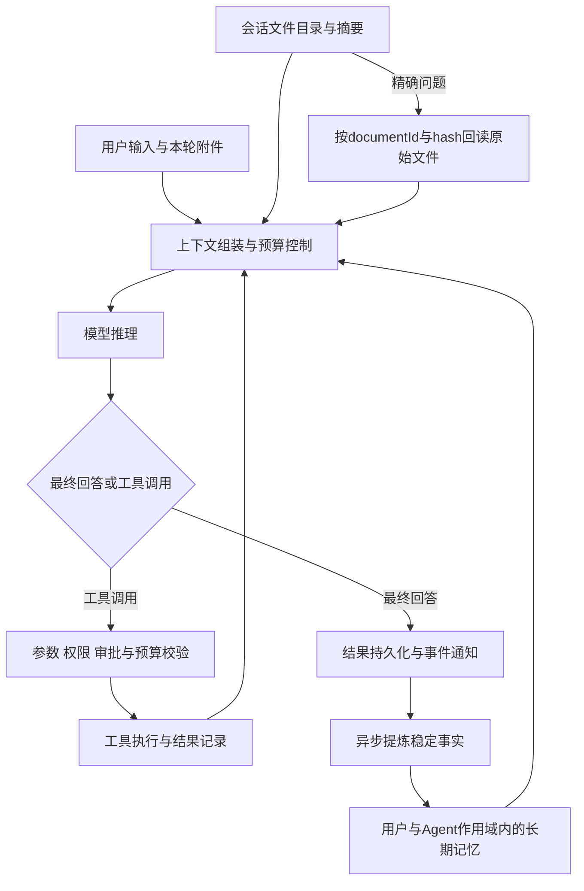
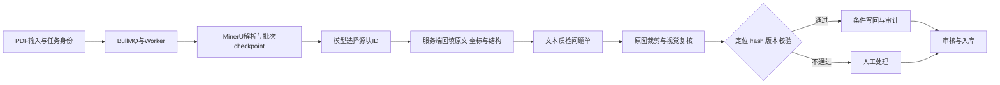

# 华为 AI 技术应用岗位：简历深挖与完整备考

依据：2026-10-14 本次对话提供的简历。准备定位：软件工程硕士、校招或应届 AI 应用工程方向。未提供具体部门和 JD，因此以下是针对简历与岗位能力的预测题，不代表华为内部题库或固定面试流程。

使用方式：先掌握项目主线，再练追问。主回答适合口述，追问用于向下展开。标注「待补充」的内容必须用真实记录填写；标注「设计回答」的机制是可讨论方案，不代表你已经实现。参考回答中的“我会”不要改成“我做过”，除非能拿出实现证据。

## 目录与复习优先级

| 部分 | 题号 | 重点 | 优先级 |
|---|---|---|---|
| 一 | 001—005 | 自我介绍、岗位匹配、贡献边界 | P0 |
| 二 | 006—017 | Agent Runtime、端云协同、工具执行 | P0 |
| 三 | 018—025 | 会话文件记忆、摘要与精确回读 | P0 |
| 四 | 026—032 | 长期记忆、检索与事实治理 | P0 |
| 五 | 033—037 | 埋点、幂等、数据闭环 | P1 |
| 六 | 038—052 | 教辅解析、队列、质检与指标 | P0 |
| 七 | 053—062 | 检索、推荐、异常检测与预测 | P1 |
| 八 | 063—073 | 多模态比赛、蒸馏、LoRA、昇腾 | P0 |
| 九 | 074—088 | Transformer、RAG、推理部署基础 | P0 |
| 十 | 089—100 | 后端、数据库、前端与工程排障 | P1 |
| 十一 | 101—106 | 企业应用系统设计 | P1 |
| 十二 | 107—114 | 行为面与业务沟通 | P1 |
| 十三 | 115—120 | 手写代码与算法题 | P0 |
| 附录 | — | 指标口径、7天计划、模拟面试、速查清单 | P0 |

## 面试前必须核实的事实

| 简历陈述 | 必须准备的真实证据或口径 | 不要这样表述 |
|---|---|---|
| 参与 JF-AIX 平台 | 团队分工、本人负责模块、一次代码路径或设计图 | “整个平台都是我做的” |
| Pi Agent SDK、自定义 Loop | 实际 SDK 版本、接入接口、修改点与事件序列 | 把通用框架知识说成 SDK 的固定实现 |
| L6 动态上下文 | 项目内部层级定义、注入位置、预算与优先级 | “行业通用的第六层记忆” |
| 降低 Token 和通信开销 | 同一组会话的前后对照、统计边界 | 虚构百分比或只报估算值 |
| 6,862 本、72.9 万页、125.2 万题 | 截止时间、去重规则、导入量/解析量/审核量的区别 | 全部题目都做了高质量验收 |
| 80 本、14.4 万题质检 | 与累计规模的包含关系、完成状态 | 把子集效果推广到全量 |
| 准确率约95%→98% | 样本量、抽样、正确判定、独立人工复核、同口径比较 | 把模型问题单通过率叫内容准确率 |
| 40 min→18 min | 同类教材、计时起止、均值样本、人的时间/机器耗时 | 全流程总耗时下降55% |
| 比赛冠军/三等奖 | 正式赛道名称、队名/排名证明、个人分工 | 把赛事子任务冠军说成整个大会冠军 |
| 80.9%、38%→62% | 数据划分、评测脚本、是否同口径、是否污染 | 训练集提升等于泛化能力提升 |
| 8卡昇腾910B | 实际训练框架与版本、精度、并行、配置、本人操作 | 仅使用过环境就声称熟悉底层算子开发 |
| WACV/CVPR 两条简写经历 | 任务、数据、方法、指标、个人贡献各一项 | 只记得奖项，解释不了方法 |

---

## 一、自我介绍与简历总览

### 001｜请做一个两分钟自我介绍

**参考回答：** 我是南京理工大学软件工程硕士在读，主要做 LLM Agent 和 AI 应用工程。我的经历集中在两条线：一条是企业 Agent 的运行与上下文管理，一条是把模型接入文档生产和审核流程。在九方智投，我参与 JF-AIX 平台，重点负责 Runtime 上下文工程，包括会话文件记忆、跨会话长期记忆以及产品埋点。在独立开发的教辅平台中，我把 PDF 解析、结构化切题、AI 质检、人工校对和入库串起来，累计平台数据达到125.2万题，质检落地子集为80本、14.4万题。此前在中电科28所实习，做过语义检索、推荐和运行监控。我也参与过视频理解和数学推理竞赛，接触过模型微调和昇腾训练。我的优势是能把模型能力和任务状态、数据一致性、评测及人工流程一起设计，希望在 AI 技术应用岗位继续做可交付的行业应用。

**追问：你更偏算法还是开发？** 我偏 AI 应用工程，能够理解训练和推理机制，并把模型输出接成稳定业务流程。算法经历帮助我判断模型边界，工程经历帮助我解决质量、时延、成本和恢复问题。

**追问：用30秒概括？** 我主要做企业 Agent 和文档智能应用，既做过 Agent 上下文与记忆，也独立做过从 PDF 到题目入库的业务闭环，能把模型效果、后端可靠性和人工审核结合起来。

### 002｜为什么选择 AI 技术应用岗位，为什么投华为？

**参考回答：** 我更希望承担从业务问题定义、方案选型到部署验证的工作。过去项目让我意识到，调用模型只是起点，能否追溯原文、控制工具副作用、恢复任务、量化收益，才决定应用能否持续使用。选择华为，是希望结合具体团队的行业场景和软硬件环境做落地；我的昇腾训练经历可以作为适应相关技术栈的起点。具体业务匹配我会结合面试团队的方向说明，而不把公司所有业务都归到这个岗位。

**追问：你了解我们部门吗？** 当前没有部门信息时，应答“我了解到岗位属于AI技术应用方向，具体客户、产品和交付边界希望进一步了解；我可以先用企业Agent或文档智能说明自己的匹配能力”。面试前用实际JD补齐三项：产品、客户、岗位职责。

### 003｜你最有竞争力的能力是什么？

**参考回答：** 是把不确定的模型结果放进可验证的工程流程。教辅平台中，模型返回源块ID，服务端回填原文，降低直接改写带来的问题；质检时再用原图复核，并在写回前验证版本和内容。Agent中则需要限制工具循环、处理取消、管理上下文和持久化结果。我通常先明确哪些事情交给模型判断，哪些必须由程序约束，再用业务样本验证效果。

**追问：全栈会不会不够深入？** 我把深度放在AI应用链路中的上下文、异步任务和质量控制，前端能力用于完成交互和验证闭环。不会把熟悉Vue等同于精通所有前端底层。

### 004｜这么多项目，哪些是你独立做的？

**参考回答：** 教辅平台是我独立设计实现的，能够解释从页面请求到Worker、模型调用、数据库写入的完整路径。两段实习都是团队项目，我的贡献分别是检索推荐监控模块，以及Agent上下文、记忆和数据闭环相关模块。比赛是团队成果，需要逐项说清我负责的数据、训练或推理环节。面试时我会先讲个人负责部分，再说明协作接口。

**追问：讲一个你亲自改过的函数？** 用真实代码回答“入口文件/函数→输入→核心分支→状态写入→失败处理→验证方式”。本简历没有函数名，不能临场编造；面前准备三个真实代码切片。

### 005｜你遇到过的最难问题是什么？

**参考回答：** 可以选择“题目与答案分离、跨页且存在双栏”的切题问题。单纯让模型输出整道题容易改写原文，也容易把不同章节的同题号配错。我把模型任务收敛为识别源块归属，程序负责回填内容和坐标，再用章节标题与题号约束配对。这个方案保留了定位依据，也让人工能回到原PDF检查。困难在于结构识别与业务约束必须一起设计，而不是继续增加Prompt长度。

**追问：最终解决了所有错配吗？** 没有。章节标题识别错误、重号和缺失答案仍可能出现，需要置信或规则检查和人工确认；具体实际兜底以项目实现为准。

---

## 二、Agent Runtime 与端云协同

### 006｜Agent 与普通大模型聊天、工作流有什么区别？

**参考回答：** 普通聊天主要输出文本；Agent在目标和权限约束下选择工具、观察结果并继续决策；工作流由程序预先确定主要步骤。实际系统可以混合：确定性的入库、校验、审批用工作流，信息不全、需要动态选择工具的部分用Agent。自主性越强，越需要执行预算、权限控制和可恢复状态。

**追问：ReAct是什么？** 是将推理与行动交替组织的方法，可表现为选择工具、执行工具、接收观察后再决策。生产中不必暴露模型内部思维链，只记录可审计的动作、工具输入输出摘要和结果。

### 007｜画一下你们的 Agent 执行链路

**参考回答：** 可以按“用户输入→组装上下文→模型流式推理→判断最终回答或工具调用→参数校验→权限与人工确认→执行工具→工具结果回填→下一轮推理→结果持久化”展开。Electron与Vue承接用户交互和端侧执行，NestJS承担云侧控制相关能力。我的重点是上下文、执行控制和事件链路；具体哪个服务持久化哪张表，必须按真实项目画。

**追问：最小状态机怎么设计？** 设计回答：CREATED、RUNNING、WAITING_APPROVAL、CANCELLING、SUCCEEDED、FAILED、CANCELLED；终态不能被晚到的工具结果覆盖。持久化状态迁移要包含runId和版本条件。

### 008｜为什么接管自定义 Loop，而不是直接用 SDK 默认行为？

**参考回答：** 企业执行链路需要把模型推理与工具权限、人工确认、中断、输出限制和持久化接在一起。接管Loop可以在模型调用与工具执行之间插入这些控制点。SDK提供已有能力，我们只补产品需要的执行策略，而不重写模型协议和所有基础模块。准确接口名和改动范围需要以实际Pi Agent SDK版本和代码为准。

**追问：自己写Loop的代价？** 要维护协议兼容、流式事件、工具异常和状态一致性。我会优先保留SDK稳定部分，对控制点做薄扩展，并用包含多次工具调用、取消和恢复的回放用例验证。

### 009｜如何防止工具无限循环？

**参考回答：** 单一“最大轮数”不够，需要总步数、单工具耗时、总Token或费用预算，以及重复无进展检测。重复检测可结合工具名、规范化参数与结果摘要，但不能把所有重复调用都视为错误，例如合法轮询。触发限制后应明确返回已完成内容和停止原因，而不是伪造成功。简历确认做过循环熔断，实际阈值与检测规则待补充。

**追问：模型不断换参数也能绕过？** 所以还需要全局预算和任务级进展信号；相似参数检测只能补充，不能替代硬上限。

### 010｜工具参数如何校验？

**参考回答：** 模型输出先作为不可信输入解析，再校验类型、必填项、枚举和长度等结构约束，之后做业务规则和权限校验，例如目标资源是否属于当前用户。不能因为JSON格式正确就执行。错误应返回可修正的简短信息，限制修正次数；工具内部仍保留关键校验，避免其他调用入口绕过。

**追问：模型输出JSON不完整怎么办？** 流式片段先累积，等工具调用结束事件到达再解析。若协议支持结构化输出也仍要服务端校验；解析失败不执行半截参数。

### 011｜Abort 如何真正中断任务？

**参考回答：** 中断是取消信号在整条链路中的传播。需要停止继续请求模型、阻止新工具启动，并把信号传给支持取消的网络请求或子进程；不支持取消的动作要标记取消请求、隔离晚到结果并记录最终实际状态。关闭SSE只是断开显示，不等于后端停止执行。已发生的外部副作用也不会被Abort自动撤销。

**追问：用户取消时工具已提交付款或写库？** 必须查询业务实际状态，避免重试重复提交。设计上使用业务幂等键，必要时走补偿或人工处理，不把取消当作数据库回滚。

### 012｜可恢复执行如何避免重复调用工具？

**参考回答：** 设计回答：为一次工具意图生成稳定callId，记录PENDING/RUNNING/SUCCEEDED/FAILED及结果引用。恢复时复用已完成结果，对“发出请求但没收到回执”的调用先查询外部状态；外部接口支持时传幂等键。只保存聊天记录无法知道副作用是否完成。简历写了可恢复闭环，实际持久化粒度、恢复入口和外部幂等覆盖范围需要补充。

**追问：数据库写完状态、请求没发出去呢？** 这是跨系统原子性问题，不能仅靠本地事务宣称exactly-once。根据接口能力用状态查询、outbox、幂等接收与补偿，使至少一次尝试产生可控业务结果。

### 013｜Tool 与 Skill 有什么区别？MCP又是什么？

**参考回答：** Tool通常是具有明确输入输出的可执行能力；Skill常包含任务步骤、领域说明和可调用资源，具体语义由项目定义。MCP是连接模型应用与外部工具、资源等能力的协议，不等于Agent规划算法，也不自动提供权限隔离。模型通过调用入口执行动作，应用仍负责鉴权、参数校验、审批和审计。

**追问：MCP工具返回“忽略原指令”怎么办？** 工具返回值是数据，不应升级为系统指令。按来源与用途隔离上下文，并通过执行权限、敏感动作确认和输出过滤控制后果，不能只依赖一句防注入Prompt。

### 014｜端云为什么要分开？Electron有哪些风险？

**参考回答：** 端侧适合访问用户本地文件与受控本机工具，云侧适合账号、配置、控制和跨端业务状态。代价是离线、版本差异、通信安全和状态同步。Electron中应遵守最小IPC能力、隔离Renderer与特权执行域、校验消息来源与参数；密钥不应直接暴露给页面脚本。这里是设计原则，具体隔离配置需按实际项目确认。

**追问：为什么Renderer不能直接执行任意命令？** 页面内容和依赖可能受攻击；任意IPC或shell入口会把UI漏洞扩大为本机权限。应暴露按业务定义的窄接口，而非通用命令执行接口。

### 015｜人工确认放在哪里？用户点同意后就永久有效吗？

**参考回答：** 确认应发生在真实执行前，展示要操作的对象、动作和关键参数。确认绑定当前runId、调用意图和参数摘要，参数变化或确认过期应重新确认。高风险动作即使模型认为“用户已经同意”也必须由执行系统判断。具体审批类型和有效期属于项目实现细节，简历没有给出固定策略。

**追问：恢复后能复用确认吗？** 只有对象、参数、权限和有效期都仍匹配时才考虑复用，不能只按工具名复用历史批准。

### 016｜流式事件如何避免乱序、重复和断线丢失？

**参考回答：** 设计回答：每个run有独立事件序号，事件包含runId、eventId、type和必要payload。前端按事件类型更新，按ID去重，忽略不属于当前run的事件。可重放事件持久化或定期保存快照，重连时从游标恢复。网络断开不直接改变业务终态；最终结果以服务端事实为准。

**追问：Token事件都要落库吗？** 不一定。可以聚合文本、保存关键状态和工具事件，按产品要求在事件重放精度与存储成本之间取舍。没有持久化的片段不能承诺任意重放。

### 017｜如何评估一个Agent，而不只看“回答看起来不错”？

**参考回答：** 用真实任务集分层评估：业务完成率、工具选择和参数正确率、无效调用比例、取消及恢复成功率，再看P50/P95时延、Token和单次成功任务成本。工具有副作用时要检查最终业务状态，不能只读最终文字。对模型、Prompt和工具版本做固定记录，并用错误分类指导优化。

**追问：LLM做裁判可靠吗？** 可以辅助扩展评测，但需固定判据、抽取人工复核，并监控偏差。可程序验证的写库结果和结构字段优先使用确定性检查。

---

## 三、会话级多模态文件记忆

### 018｜为什么文件记忆没有做分块和向量库？

**参考回答：** 这个模块面向会话内少量小型附件，首轮需要模型完整理解，后续主要引用摘要。直接引入分块、索引和召回会增加状态与运维成本，也可能丢失表格或上下文关联。因此采用首轮原始内容注入、异步摘要、后续摘要引用和按需回读。它有明确规模边界；大文档、多文件知识库和跨文件检索应考虑分块与RAG。

**追问：多大就要改RAG？** 不报通用页数阈值，要依据解析后的Token量、模型窗口、任务精度和延迟预算压测。需要补充当时附件数量、体积和Token上限。

### 019｜摘要丢失细节后怎么精确回答？

**参考回答：** 摘要用于判断内容和定位文件，原文件仍是事实来源。需要金额、日期、单元格或原句时，通过documentId和内容版本回读原始内容。没有分块索引时，回读可能需要读取整个小文件或按已有结构读取，不能把它说成已经具备精准向量片段检索。回读失败或原文不支持时，不应靠摘要猜数字。

**追问：模型怎么知道何时回读？** 提供清晰的文件目录、摘要和回读工具约定，对精确引用类任务强调必须回读；还需要评测“该回读未回读”和“无必要回读”的比例，单靠Prompt无法保证。

### 020｜首轮原文与异步摘要之间存在竞态怎么办？

**参考回答：** 设计回答：文件摘要至少区分pending、ready、failed，并绑定文件hash。摘要未就绪时，下一轮按预算继续使用原始内容或明确等待/回读，而不是把pending当成空文件。摘要任务完成后，只能覆盖同版本文件的摘要；文件内容变更则丢弃旧任务结果。摘要失败应可重试，且不能阻塞主对话无期限等待。

**追问：用户连续发两条消息会重复注入吗？** 需要以服务端或执行域确认的注入状态为准，不能只靠Renderer临时标记；并发轮次要绑定run与文件版本，实际实现待核实。

### 021｜Renderer、本机缓存、Server Metadata各存什么？

**参考回答：** Renderer负责当前会话交互状态；Electron本机缓存承载附件内容和可复用派生结果；Server Metadata承载引用、标识和版本等元信息。三级分层的目的是让大内容、界面状态和云端引用各有边界。元数据具体字段以及服务端是否保存摘要，需要按真实结构确认，不能直接推断所有正文都同步云端。

**追问：换一台电脑能恢复原文件吗？** 仅有服务端元数据无法恢复只保存在旧电脑的正文。跨设备恢复要另有对象存储或重新上传；简历确认的是应用重启恢复，不能扩展为跨设备完整恢复。

### 022｜documentId + hash为什么要同时存在？

**参考回答：** documentId表达逻辑文件身份，hash表达某份具体内容。相同ID内容变更时，摘要和缓存必须失效；相同内容不同文件ID则不一定应该合并，因为权限与业务归属可能不同。hash应基于稳定字节或明确定义的规范化内容计算，不能用文件名和修改时间替代内容校验。

**追问：hash能证明权限吗？** 不能。知道内容hash不代表有权读取，缓存命中仍要校验会话和用户授权，且区分缓存隔离范围。

### 023｜什么是原子写入？如何处理Draft Session迁移？

**参考回答：** 原子写入通常先写临时文件，完成必要检查后在同一文件系统内rename替换，避免读到半截数据；是否fsync取决于耐久性要求。Draft Session迁移需要把临时会话引用关联到正式sessionId，过程中保留可恢复映射，并避免先删旧文件再创建新引用。具体迁移顺序与文件格式需要用真实代码补齐。

**追问：原子rename等于绝不丢数据吗？** 不等于。它主要解决替换可见性；断电耐久性、跨文件系统移动、多个文件一起更新仍有额外约束。

### 024｜图片和表格为什么不能只存一段摘要？

**参考回答：** 图片描述会丢失局部文字、空间位置和细粒度关系；表格摘要容易丢失行列对应、单位和合并单元格含义。因此后续可用描述快速判断相关性，但对细节应回读图片或保留结构化表格。描述不等于OCR，OCR也不等于理解图表。模型不确定时应呈现原图和定位依据。

**追问：图片Token能直接按文本字符估算吗？** 不能。图片计费和输入Token取决于模型及图像处理方式，应使用供应商返回的usage或已验证的统计方法，避免把base64长度当Token量。

### 025｜如何证明这套记忆真的节省了成本？

**参考回答：** 固定模型、相同文件和多轮问题，对比每轮重复注入原内容与摘要加回读方案，统计输入输出Token、摘要费用、回读次数、通信字节、时延和答案正确率。总成本必须包含异步摘要和额外回读，短会话可能不划算。简历没有给出节省比例，我只会先说明机制，补充真实对照后再报数字。

**追问：缓存命中率很高就代表节省了？** 不代表。还要看命中后减少了多少实际传输或推理成本，以及是否因旧缓存导致错误回答。

---

## 四、跨会话长期记忆

### 026｜长期记忆与聊天历史、会话文件记忆有什么区别？

**参考回答：** 聊天历史记录发生过什么，可能很长且包含临时信息；会话文件记忆服务当前会话附件；长期记忆保留跨会话仍有价值的稳定事实。我们将长期记忆分为user、feedback、project、reference四类，按用户与Agent作用域召回，避免把所有聊天和附件直接永久化。类别的准确字段和例子应按实际项目解释。

**追问：reference不是也可能来自文件吗？** 关键在生命周期、授权和确认依据。临时附件不会自动升级为长期事实；明确要求长期保存的稳定参考信息，需通过单独的提取和确认规则处理。

### 027｜为什么用MySQL加Elasticsearch，而不是只用向量库？

**参考回答：** MySQL适合保存权威事实、作用域、版本和生命周期，Elasticsearch提供向量候选召回，两者职责不同。检索索引不是事实源，可以重建。引入ES的前提是团队已有相关能力与检索需求，否则小规模也可以评估数据库向量扩展，不能因为“向量检索”就必然选择某个独立系统。

**追问：MySQL更新了，ES没有更新怎么办？** 设计回答：事务提交后可靠触发索引更新，使用重试、版本号和对账。召回后校验记录是否仍有效；删除与权限变更尤其不能只依赖旧索引。

### 028｜为什么向量召回以后还要LLM严选？

**参考回答：** 语义相近不等于对当前任务有用。例如“Python开发偏好”与某个项目故障可能相似但不能帮助回答。向量检索做低成本候选缩小，再让LLM结合当前问题筛选可用事实，可以减少无关上下文。代价是额外时延与误删；需要限制候选数、提供明确选择标准，并比较严选前后的任务效果。

**追问：怎样防止LLM严选时改写或新增事实？** 要求返回候选ID或明确选择结果，程序回填原始记忆；不接受凭空生成的新记忆作为检索结果。简历未说明是否这样实现，这是建议的结构约束。

### 029｜长期记忆提取发生在什么时候？会影响聊天速度吗？

**参考回答：** 简历中的实现是在每轮结束后异步提炼稳定事实，主响应不等待全部写入。但异步任务仍需控制并发、超时、重试和积压，否则会抢占模型资源。应记录从会话轮次到记忆任务的关联，避免失败后静默丢失。是否已有独立队列、如何保证任务投递，需要用实际实现回答。

**追问：刚说完的新事实下一轮还没入长期记忆怎么办？** 同一会话先从当前对话上下文获得；跨会话检索可能短暂滞后，需要明确最终一致性边界，不能宣称异步写入立即全局可见。

### 030｜用户说法变了，旧记忆怎么办？

**参考回答：** 设计回答：记忆需要来源、时间、有效状态和作用域。明确新陈述与旧值冲突时，不能简单把两条都注入；可把新事实设为当前值、旧事实标记被替代，保留必要审计依据。不确定是新项目还是原事实变化时，先保留上下文并询问，不能让提取模型自行编造合并结论。

**追问：用户要求删除记忆怎么办？** 删除权威记录或设为不可检索，并清除索引、缓存及相关派生副本，考虑备份保留政策；同时验证重新检索不会再次注入。具体产品是否支持删除需真实说明。

### 031｜如何避免记忆污染和跨用户泄漏？

**参考回答：** 提取阶段区分用户明确事实、引用内容、假设和模型建议，不把助手猜测当用户事实；持久化和检索阶段强制用户、租户与Agent权限过滤，不能依赖Prompt过滤。注入时只接受当前权限范围内的有效记录。临时附件与长期记忆分离，可以减少来源不明信息长期污染。

**追问：先全量向量检索再过滤可以吗？** 权限过滤应尽可能进入检索约束，并在回填时再次检查；仅取topK后过滤容易召回不足，更不能把其他用户候选发给LLM再筛。

### 032｜L6是什么？长期记忆怎么控制上下文预算？

**参考回答：** L6是项目内部动态上下文的层级命名，不是通用标准。我需要结合项目的其他层级、组装顺序和优先级解释它。长期记忆注入应设置Token预算，优先保留与当前任务直接相关、更新且可靠的事实，避免挤掉用户当前问题与关键工具结果。实际预算与截断策略待补充。

**追问：如何证明长期记忆有用？** 构建跨会话偏好、项目延续、事实更新和无关记忆干扰的任务集，对比开关记忆后的任务正确率、误注入率、过期事实使用率、延迟和成本。

---

## 五、产品可观测性与数据闭环

### 033｜12类标准事件怎么设计，为什么不直接记录所有点击？

**参考回答：** 从业务问题出发建立事件，而不是堆点击日志。简历覆盖启动、活跃、会话、消息、文件、专家/助手、技能及应用等域；面试应准备实际12类事件名称与触发条件，这些不能靠现有信息补造。公共字段可包括eventId、事件版本、时间、来源与匿名化业务标识，具体以实现为准。重要的是不同端对同一业务概念口径一致。

**追问：会话创建和消息发送算同一个事件吗？** 应依据实际业务区分。可以分析从启动到首次有效会话的漏斗，但每个事件必须有唯一、可重复解释的触发条件。

### 034｜为什么30秒刷新、每批100条、最多2000条？

**参考回答：** 这是时效性、网络开销和本地存储之间的工程折中。30秒避免每个事件都发请求，每批100条控制单次请求体，2000条限制离线缓存增长。需要补充这些参数当时是经验初值还是压测结果。队列满时必须有明确策略，例如丢弃低优先级或最旧数据并计数，不能声称离线永不丢事件。

**追问：2000条能离线多久？** 取决于事件产生速率；可保留时长约为2000除以每秒事件数。还要考虑事件大小，而不仅是条数。

### 035｜dedupHash如何做到幂等？

**参考回答：** hash只是标识手段，幂等依赖稳定事件身份与服务端原子唯一约束。重试同一事件必须保留同一标识，不能每次重新用当前时间生成。不同的合法重复动作也不能被合并。实际dedupHash组成字段、唯一索引和冲突处理需要用项目实现说明；不要简单对整个含变化时间的payload求hash。

**追问：查询没有再插入会不会重复？** 并发下会。需要数据库唯一约束或等价原子机制，让竞争插入只有一次生效，不能把“先查后写”当幂等保证。

### 036｜Desktop事件与Server派生事件会重复统计吗？

**参考回答：** 两端观测的事实不同：客户端更适合启动和交互，服务端更适合任务成功、消息持久化等业务完成事实。要指定指标的权威来源，必要时用业务ID关联，不能把两端同名事件直接相加。服务端异步派生事件不应拖慢核心请求，同时需要失败可见和补偿路径。

**追问：如何不丢“数据库已成功但事件没发出”？** 若要求可靠，可用业务事务与outbox同写再异步发送；若只是允许少量丢失的统计事件，也要明确边界。简历未声明采用outbox，不能说已实现。

### 037｜不采集正文还怎么做产品分析？

**参考回答：** 活跃、漏斗、功能使用、成功率和延迟通常只需要结构化元数据，如事件类型、结果码、耗时、大小区间和关联ID。避免记录消息正文、文件内容和敏感路径；排障可依赖脱敏错误类别和traceId，必要内容应走另一个受控流程。数据闭环还要说明分析如何产生改进，而不只是“接了埋点”。

**追问：你具体基于埋点做了哪次优化？** 当前简历只证明建设能力，具体分析和优化结果待补充。没有真实案例时说“我完成了采集与去重基础，尚不能归因某项产品提升”。

---

## 六、教辅录题与审核平台

### 038｜整体架构是什么？为什么独立做这个项目？

**参考回答：** 平台解决教材从PDF到结构化题库、再到可审核入库的流程问题。Vue3负责审核交互，Fastify提供业务接口，PostgreSQL存业务状态与结构化结果，Redis和BullMQ承接异步任务，MinerU用于文档解析，模型服务用于结构判断和质检。用户提交任务后拿到jobId，Worker执行，SSE通知进度。真实起因、用户来源和部署资源需要自己补齐，不能假设商业客户或营收。

**追问：为什么用Node而不是全Python？** API与前端共享TypeScript生态，BullMQ满足任务调度；文档解析和模型处理可通过进程或服务连接Python工具。语言选择以团队能力和I/O型任务为依据，不能声称Node计算性能天然更强。

### 039｜MinerU输出什么？为什么不用普通OCR？

**参考回答：** 这里用到的是解析后的块级内容、坐标与文档结构信息。OCR主要解决文字识别，切题还依赖版面、阅读顺序、公式、表格和章节边界。数字PDF和扫描PDF处理方式也不相同。MinerU仍可能漏块、识别错序或错误解析公式，需要保留原页与定位信息用于检查。

**追问：坐标能直接拿来裁原图吗？** 必须确认坐标单位、页面尺寸、渲染分辨率、原点方向和旋转；按比例映射并做边界裁剪，不能把PDF点坐标直接当像素。

### 040｜为什么让模型输出源块ID，而不是直接输出题目JSON正文？

**参考回答：** 我把模型任务限定为结构归属判断：哪些块属于题干、选项、答案和解析，服务端再按ID回填原文及坐标。这样减少模型润色、漏字和数字变更，也便于回到PDF验证。它保证的是内容来源可追溯，并不保证选到的块必然正确，因此仍要检查遗漏、重复归属和结构异常。

**追问：模型生成不存在的blockId怎么办？** 校验ID属于当前允许块集合，拒绝越界引用；对必需字段缺失或冲突保留错误状态，不直接入库。结构化输出只提高可解析性，不能替代引用有效性校验。

### 041｜跨页、双栏与章节边界分别怎么处理？

**参考回答：** 跨页需要保留相邻页的上下文和块顺序；双栏要用版面阅读顺序而不是全页单纯按纵坐标排序；章节边界限定题目归属，避免上一章末尾和下一章开头串题。批次切分尽量沿结构边界，跨批的未完成题需要保留关联信息。具体使用的窗口、重叠和跨批合并规则待补充。

**追问：直接增加上下文窗口不就解决了吗？** 不能。阅读顺序错误和章节识别错误不会因窗口变大自动消失，还会提高成本并增加无关内容干扰。

### 042｜题目和答案不在一起，怎么配对？

**参考回答：** 基础键是章节标题与题号，而不是全书只按题号。先建立章节归属，再关联题目页与答案页；章节标题有差异或题号有子层级时，需要规范化和歧义检查。只使用“章节+题号”仍可能发生同章节重号，所以对不唯一匹配必须保留待人工状态，不能强行配对。

**追问：1、1.、（1）如何区分？** 先识别大题与小题层级，再做形式规范化；不能把所有括号和标点都去掉后直接当同一键。实际题号表达与章节ID需查代码。

### 043｜长任务为什么不能在HTTP请求里直接完成？

**参考回答：** PDF解析与模型调用可能持续很久，会遇到代理超时、用户刷新、资源争用和失败重试。接口快速返回jobId，任务状态持久化，Worker独立消费，前端订阅进度，能把连接生命周期与业务生命周期分离。队列只是调度机制，任务状态和中间结果仍要可靠保存。

**追问：SSE断了任务就失败吗？** 不会。SSE只是进度通道，重连后查询任务状态或恢复订阅；是否支持事件重放取决于是否保存事件及游标。

### 044｜checkpoint怎么实现，怎样知道一批已经成功？

**参考回答：** checkpoint以批次为粒度，记录当前输入版本、批次标识、执行状态和结果。只有输出通过校验并可靠保存后，才能把该批次标为成功；重跑时跳过同一输入版本下成功的批次。不能只记录“最后处理到第几页”，因为并发批次可能乱序完成，页面也可能更新。

**追问：结果已写入，成功标记前崩溃？** 最好在同一数据库事务提交结果与批次成功状态；若跨存储，需要用稳定结果键、幂等写入和对账恢复，不能仅靠checkpoint消除所有重复。

### 045｜内容hash加Prompt版本能完全防重复计费吗？

**参考回答：** 能减少相同任务重复发起，但不是绝对保证。任务身份最好包含租户、输入内容版本、模型配置和Prompt版本等影响结果的因素；Redis锁用于竞争协调，结果记录用于复用。若供应商已完成推理而响应丢失，且没有可查询的请求ID或幂等接口，重试仍可能再次计费，不能承诺完全避免。

**追问：Prompt只改一个标点要重跑吗？** 是否重跑取决于版本策略。可用明确的发布版本标记语义变化，避免不可控缓存；关键是输入和Prompt身份可追溯，不能拿旧结果冒充新配置输出。

### 046｜Redis锁有哪些坑？

**参考回答：** 常见坑是无过期时间、任务超过TTL、多客户端错误解锁，以及锁过期后旧Worker继续提交。通常用SET NX带租约和随机持有者token，解锁原子校验token；长任务需要合理续租。对写入结果仍需要唯一约束、版本条件或fencing机制，不能把Redis锁当业务一致性的唯一保障。

**追问：锁还没过期就进程死了怎么办？** 等租约过期后允许接管；接管依赖已持久化checkpoint。恢复后旧进程若又继续，提交还必须通过所有权或版本校验。

### 047｜失败怎么重试？为什么不能所有错误都重试？

**参考回答：** 网络超时、限流、短暂服务错误可以退避加抖动后重试；输入损坏、权限失败、结构持续不合法不宜无限重试。设单次超时、次数与总费用预算，保存失败原因，耗尽后转人工或待处理。Worker接到取消信号也不应重新排队无限启动。实际退避参数和死信处理需补齐。

**追问：怎么控制模型供应商的QPS和Token限额？** 分开控制请求速率、Token预算和在途并发，多Worker共享限流状态；收到429后按实际协议退避，不只简单减少一个进程的并发。

### 048｜文本质检后为什么再调用视觉模型？

**参考回答：** 文本模型能发现疑似错字、缺失、公式或逻辑问题，但不知道原图到底是什么。按坐标裁剪原图再复核，可以检查问题是否有视觉依据，减少对正确内容的误报。视觉模型也会犯错，因此它是第二证据通道，而不是绝对裁判；裁图不完整时应扩大上下文或交给人工。

**追问：两个模型都同意就能自动改吗？** 不能。还要满足原文定位唯一、内容hash和稿件版本一致等写回条件，高风险或证据不足问题仍应人工审核。

### 049｜安全写回具体防什么？

**参考回答：** 防的是改错位置、改旧稿和覆盖人工修改。问题单带原文、位置与建议，写回时确认原文能唯一定位，当前内容hash符合预期，稿件版本未变化。通过后进行条件更新并记录改动；任一条件不满足则不自动修复。不能使用全局字符串replace直接替换所有相同片段。

**追问：校验刚完成，别人就改了稿件呢？** 检查与更新要在同一事务或同一条件更新中完成，例如WHERE version=expected；受影响行数为0即冲突，而不是检查后无条件UPDATE。

### 050｜95%到98%是怎么统计的？

**参考回答：** 必须先定义“准确”：是整题所有字段都正确，还是按字段统计，是否包含答案与解析正确性。应对同口径样本使用独立人工判定，记录样本量、抽样方式和错误类型。简历给出约95%到98%，但没有完整统计设计，所以面试前必须补真实记录；缺少证据时应限定为已有抽检样本的观察结果，不能声称全量真实准确率。

**追问：提升3%还是3个百分点？** 是约3个百分点；以错误率衡量，从5%降到2%，相对减少约60%，前提是同口径且估计可信。

**追问：样本量多少才够？** 不能随口报固定值。取决于基线、最小可检测差异与置信要求；教材内题目相关，统计时应考虑按书或章节聚类，避免把所有题视为完全独立样本。

### 051｜40分钟降到18分钟能证明效率提升吗？

**参考回答：** 若同类教材、相同抽检范围和计时规则，平均人工抽检时间减少22分钟，降幅55%，处理速度约为原来的2.22倍。但这不等于整本教材从解析到入库的端到端耗时减少55%。还要看质量是否保持、是否增加后续返工，以及机器费用。应准备比较样本数和时间记录。

**追问：教材难度不一样怎么办？** 分教材类型、页数和题型比较，或对同一批样本做配对实验，避免简单把两组均值差归因给AI。

### 052｜125.2万题规模下，主要瓶颈是什么？

**参考回答：** 累计数据规模不等于峰值并发。需要分别看解析吞吐、模型限流、Worker资源、数据库批量写入和人工审核产能。针对瓶颈选择拆分资源池、限制并发、批量入库和增量处理。监控P95、积压和心跳能帮助定位，但简历没有QPS、机器规格和单本成本，不能编造百万级并发能力。

**追问：你还会优先做什么改进？** 先基于任务耗时分布和错误分类选择，例如高失败版型专项、复用解析结果或优化人工定位；收益未验证前不急于增加Agent或换更大模型。

---

## 七、中电科28所：检索、推荐、监控

### 053｜为什么把模型多个字段拼成检索文档？

**参考回答：** 用户常用“识别某类目标”这类任务描述搜索，而模型名称未必包含任务语义。把名称、分类、描述、关联数据集和版本说明按固定字段组织，可以补充模型能力与适用场景。需要保留字段边界、限制长度，并处理缺失和重复信息。更丰富不必然更好，低质量版本日志可能稀释主要语义。

**追问：不同版本会重复占据topK吗？** 可以在召回后按模型主实体分组，并结合版本可用性和部署条件选择；若真实系统尚未做，应作为改进方案说明。

### 054｜Qwen3-Embedding和FAISS分别做什么？

**参考回答：** Embedding模型把查询与资源文档编码为向量，FAISS负责向量索引与相似度搜索，不生成向量，也不是完整业务数据库。模型型号要与实际权重、维度和输入模板一致。上线需要固定模型版本、向量预处理方式和索引配置；更换编码模型通常需要重建文档向量与索引。

**追问：查询与文档的模板一样吗？** 不一定。部分Embedding模型有面向查询的指令模板，应按实际模型说明和项目使用方式回答，不能随意对两端加相同前缀。

### 055｜余弦相似度、内积、L2有什么关系？

**参考回答：** 余弦看方向，内积同时受方向和模长影响，L2衡量欧氏距离。对两边都单位归一化的向量，内积等于余弦，且平方L2等于2减2倍内积，因此排序等价。没有归一化时不能直接说三者等价。相似度选择也应符合模型训练和推荐用法。

**追问：FAISS用哪个索引？** 实际类型待补充。少量资源可用Flat做精确基线；规模和延迟要求提高再评估IVF、HNSW或PQ，对比召回率、内存和更新成本，不应反推项目用了哪种。

### 056｜怎么评估语义检索，关键词检索是不是没用了？

**参考回答：** 以真实任务描述与人工相关标注建立查询集，关注Recall@K、MRR或nDCG，也看后续选择成功率。语义检索更适合意图表达，但型号、版本号、专名等精确匹配仍适合关键词。可以用混合召回和重排，先和原关键词方案比较，再决定是否增加复杂度。

**追问：Recall@K怎么定义？** 在有完整相关集合时，是topK中相关文档数除以全部相关文档数；若每个问题只标一个目标，常统计目标是否进入topK。必须说明标注口径，不能把两者混用。

### 057｜模型上新或删除后怎么更新索引？

**参考回答：** 设计回答：业务库保存资源与版本，变化后更新向量和索引，记录索引版本；批量重建可新旧双索引验证后切换。删除和权限变更需确保不可用资源不返回，必要时查询结果回库校验。FAISS不同索引更新能力不同，不能假设所有类型都支持方便地在线删除。

**追问：多进程各有一份索引怎么办？** 需要统一版本发布和加载确认，或者独立检索服务，避免不同进程返回不同版本。实际部署方式、规模和更新频率待补充。

### 058｜推荐排序公式怎么设计？

**参考回答：** 简历使用历史行为、资源类型偏好与近期热度综合排序，本质上是可解释的多信号排序。回答时可写“score=w1×行为相关+w2×类型偏好+w3×时间衰减热度”，但实际信号定义、归一化和权重必须来自项目。不能直接相加点击次数和余弦值等不同量纲数据，也不能声称这是训练出来的深度推荐模型。

**追问：点击和下载权重怎么定？** 下载可能表达更强意图，但也受曝光和操作成本影响；初始权重可按业务规则设，再通过离线与线上指标调整。实际权重待补充，不能为了答案完整编数。

### 059｜冷启动、热门偏置和推荐缓存怎么处理？

**参考回答：** 新用户可从可用资源、类型选择和近期质量资源开始，新资源可获得有限探索机会。热度用时间衰减并避免热门资源永久垄断。用户级Redis缓存减少重复排序，但key应包含用户、场景与必要版本信息，权限或资源变化时失效；缓存不能把不同用户的结果串用。

**追问：推荐点击率涨了就一定更好？** 不一定，也要看下载、使用成功、覆盖率和多样性；点击率可能来自标题吸引或更多曝光，需要考虑偏差与实际任务收益。

### 060｜psutil采集的CPU和网络指标代表什么？

**参考回答：** CPU利用率与采样窗口有关，首次或非阻塞采样需要注意初始化语义；网络和磁盘I/O常返回累计计数，应取相邻样本差并除时间得到速率。内存、磁盘容量与I/O不是同一个维度。监控设计还应标记主机和采样时间，并处理计数重置及缺失样本。

**追问：容器里采集就是整机指标吗？** 不一定，取决于可见命名空间、挂载和库行为；需结合cgroup限制解释，不能把容器进程看到的宿主机容量直接当可用配额。

### 061｜为什么选DBSCAN？eps和min_samples怎么选？

**参考回答：** DBSCAN基于密度聚类，可以把稀疏点标为噪声，不需要预先指定簇数，适合探索多指标中的偏离样本。但特征尺度、参数和数据分布影响很大，需要对CPU、内存、I/O等做合理处理，并通过历史时段和运维标注验证。DBSCAN噪声不等于真实故障；连续异常时段可以由异常点按时间聚合得到。

**追问：直接把时间戳也作为维度？** 时间距离可能主导聚类，不能直接加未经缩放的时间戳。可先对滑动窗口的状态特征检测，再按时间聚合；高维或趋势变化明显时应比较阈值、Isolation Forest等基线。

### 062｜线性回归真的能预测未来7天资源吗？

**参考回答：** 它是可解释的趋势基线，适合短期近似线性增长的资源，如稳定累积的磁盘占用。对日周期、突发负载和版本变更不一定适用。需要按时间划分训练测试集、滚动回测，与持续值或季节性基线比较MAE等指标。简历中的7天趋势是辅助运维，不应说成准确预测任何资源峰值。

**追问：DBSCAN检测到异常就能解释原因吗？** 不能，只能提示偏离；要结合发布、任务量、日志和其他指标做关联排查，不能用异常检测结果直接断言根因。

---

## 八、竞赛、训练、蒸馏与昇腾

### 063｜视频理解比赛解决了什么难点？你贡献了什么？

**参考回答：** 简历里的难点是细粒度视觉辨别、遮挡推理和选项位置偏置。方法包括Qwen2.5-VL-7B指令微调、困难题挖掘、课程学习和选项乱序，推理时用题型Prompt、TTA和按题型集成，最终测试准确率80.9%。个人具体负责哪部分、基线和每项增益待补充；先明确个人贡献，再展开团队整体方案。

**追问：80.9%来自单模型吗？** 简历描述含集成，应区分单模型、增强与最终集成结果，不能把最终成绩归因给某一个训练技巧。

### 064｜视频怎样采样，采得越多越好吗？

**参考回答：** 需要在覆盖时间和保留细节之间取舍。均匀采样能覆盖全局，但可能漏掉短暂动作；更密采样提高视觉Token和显存成本，也可能加入冗余。可以按题型比较时间分辨率和空间分辨率，固定模型预算做验证。实际帧数、FPS、分辨率和视频时长上限必须由训练配置补充。

**追问：遮挡物体怎么推理？** 要结合遮挡前后状态和时序一致性，避免只看单帧；看不见时不能凭常识臆测，训练与评测应区分可视觉推断和缺乏证据的题。

### 065｜选项乱序增强为什么有效？

**参考回答：** 数据可能存在答案位置偏差，模型会利用位置捷径而不是视频证据。训练时打乱选项并同步更新标签，可以减弱这种依赖；评测时对同题多个排列观察答案内容一致性。乱序后的输出必须映射回原选项身份，不能直接对字母投票。

**追问：乱序保证没有偏置了吗？** 不保证。长度、措辞、题型分布仍可能泄漏答案，需要检查标签分布并做反事实测试。

### 066｜困难题怎么挖？课程学习怎么安排？

**参考回答：** 可以根据基线错误、低置信或多次推理不一致筛选，再按题型分析，而不是把所有错题机械重复。课程学习是改变训练样本组织，让学习由较稳定模式逐步覆盖困难情况，但要避免后期难题导致遗忘。实际难度定义、阶段比例和调度需要用实验记录回答。

**追问：反复看验证集错题是否泄漏？** 用开发集做方法选择是允许的，但反复针对同一集优化会过拟合；应保留未用于调参的独立评估，官方测试标签不能参与训练。

### 067｜TTA和多模型集成如何做，线上值得吗？

**参考回答：** TTA是推理时对输入或提示做可控变体，如帧采样或选项排列，再聚合预测；集成则组合不同模型或配置。按题型组合需要在独立开发集确定规则，不可使用测试答案挑选。它们可能提升比赛分数，但增加显存、时延和费用；产品更应比较单模型、选择性增强和蒸馏后的性价比。

**追问：为什么不让所有模型直接平均投票？** 不同模型错误高度相关，且优势题型不同；需要看互补性、校准与验证结果，不能因模型数量变多就默认有效。

### 068｜10万条CoT数据怎么蒸馏出来的？

**参考回答：** 用较强数学模型对题目生成解题过程和答案，再做校验、去重、格式处理与训练测试隔离，形成学生模型SFT数据。这里是序列或响应蒸馏，不一定涉及教师logits的KL蒸馏。简历确认教师是Qwen2.5-Math-72B，10万是数据条数；原始题目来源、候选采样和过滤保留率需要补充。

**追问：答案正确意味着CoT正确吗？** 不意味着。错误推导也可能碰巧得到正确答案，因此需要检查过程矛盾、格式与可验证步骤，并抽样人工复核。

### 069｜Math-Verify和另一个72B模型分别做什么？

**参考回答：** Math-Verify适合从输出中提取并比较数学答案等价性，不能自动验证每一步推理；LLM可以处理部分非标准答案或辅助质量筛查，但也可能同样犯错。二者结合能提高过滤能力，却不能充当绝对真值。应记录无法解析、不一致和边界样本如何处理。

**追问：怎么防止教师把测试题答案带进训练？** 按数据源和题目规范化去重，检查近重复、改数字变体和来源重叠；所有过滤与调参严格区分训练、开发与最终测试集。

### 070｜LoRA原理是什么？为什么适合8B微调？

**参考回答：** 冻结原权重W，用低秩矩阵更新ΔW=(α/r)BA，其中A形状r×d_in、B形状d_out×r，训练参数从d_out×d_in变为r(d_in+d_out)。它减少可训练参数与优化器状态，便于保存和切换任务适配器；前向仍需基础模型，激活与基础权重显存不会消失。r、目标层和学习率需要实验选择。

**追问：LoRA为什么常把一个矩阵初始化为零？** 让初始增量为零，使训练起点等于原模型，同时另一矩阵非零，后续能逐步学习有效更新。不能把两者都初始化为零再期待正常梯度传播。

### 071｜8卡昇腾910B具体怎么训练？

**参考回答：** 先说明真实的软件栈、CANN与框架版本、NPU适配层、训练脚本和启动方式，再说明精度、LoRA目标层、并行策略、序列长度、micro batch、梯度累积和checkpoint。简历只能证明在该环境做过训练，不能确定用了DDP、ZeRO或某个框架。我的答辩会围绕实际配置和一次可复现训练过程，不编造不存在的优化。

**追问：从CUDA迁到昇腾是不是改个device就行？** 通常不够，要验证算子支持、通信、精度、分布式启动、依赖和性能；先跑单卡小样本验证，再扩多卡，并核对loss和产物可用性。

**追问：多卡卡住怎么排查？** 先看各rank日志和最早错误，检查网络与集合通信、数据加载、shape与步数一致性，确认不是某rank提前退出；不能只反复重启。

### 072｜38%到62%能全部归功于LoRA吗？

**参考回答：** 不能，这通常是数据构建、训练和评测设置共同作用。要确认前后使用相同题集、Prompt、采样参数和答案判定。若都是同口径，是24个百分点提升，相对正确率提升约63.2%；还需报告样本量、题型和独立测试。用过滤前后数据、不同训练量和LoRA配置的消融才能区分贡献。

**追问：训练和推理的thinking模式一致吗？** 必须核实模型模板、是否启用思考及答案提取规则；模式变化会影响正确率和Token成本，不能将不等价配置直接对比。

### 073｜WACV距离估计和CVPR少样本检测也讲一下

**参考回答：** 这两项简历只给奖项，不足以生成可信的个人方法回答。每项准备“赛道与任务→数据与划分→基线→本人改动→指标→失败案例”。距离估计要清楚输入是单目图像、目标框还是其他模态，单位和误差定义；少样本检测要清楚base/novel类、K-shot采样、支持集与评估mAP设置。

**追问：少样本微调的核心困难是什么？** 样本少导致过拟合、类别泛化困难和采样方差大；应报告多种子或官方协议下的结果，避免仅用最好一次。

**追问：不方便公开训练代码怎么办？** 可说明个人贡献、方法、实验设计和公开可讲的结论，不泄露受限数据；不能以保密为由回避基本原理和本人工作。

---

## 九、LLM、RAG与推理部署基础

### 074｜Transformer的Self-Attention怎么算？

**参考回答：** 输入X经线性映射得到Q、K、V，单头注意力是softmax(QKᵀ/√d_k+mask)V。QK计算位置间相关性，缩放控制分数尺度，mask屏蔽不可见位置，权重对V加权求和。多头在不同子空间建模，之后拼接投影。Decoder-only模型的因果mask使当前位置不能看到未来Token；FFN负责逐位置非线性变换。

**追问：复杂度为什么是平方？** 长度n时有n×n注意力分数，标准注意力相关计算为O(n²d)，显式分数矩阵空间O(n²)。不能据此说整个模型所有层的计算只有O(n²)，投影和FFN也有成本。

### 075｜位置编码、RoPE、残差和归一化分别有什么用？

**参考回答：** 注意力本身缺乏序列位置概念，需要位置信息；RoPE对Q、K按位置做旋转，使内积包含相对位置信息。残差帮助信息和梯度跨层传递，归一化稳定训练。LayerNorm通常减均值并按方差归一化，RMSNorm按均方根缩放，不做同样的中心化。具体模型结构要查相应配置。

**追问：使用RoPE就可以无限长上下文吗？** 不能。超出训练分布可能退化，扩展需要合适的位置策略、训练与实际长文本评测，同时仍受显存和时延约束。

### 076｜预训练、SFT、RLHF、DPO有什么区别？

**参考回答：** 预训练主要通过大规模数据学习Token分布，SFT用任务示范学习指令响应，RLHF通常利用偏好与奖励信号进一步优化策略。DPO直接通过偏好对和参考策略构造训练目标，无需显式训练独立奖励模型并在线跑传统RL流程，但不意味着完全没有参考模型或资源成本。我的简历确认有指令微调和LoRA，不能扩展为做过RLHF。

**追问：SFT数据越多越好吗？** 不一定。噪声、重复、风格不一致和错误推理会损害效果，应同时看数据质量、覆盖和独立评测，而不是只报条数。

### 077｜Temperature、top-k、top-p与幻觉有什么关系？

**参考回答：** Temperature对logits缩放，低温使分布更集中；top-k只保留概率最高的k个候选，top-p保留累计概率达到阈值的最小候选集合。它们控制采样方式，不提供事实正确性保证。低温适合结构化稳定输出，但模型最可能的答案也可能错误；降低温度不能替代检索、校验和证据。

**追问：温度0就百分百复现吗？** 不应绝对承诺，服务实现、并行计算、模型版本和数值差异都可能影响结果；应记录版本和参数并测试复现程度。

### 078｜一套完整RAG链路是什么？

**参考回答：** 离线做文档采集、清洗解析、结构切分、元数据与权限绑定、Embedding和索引；在线先理解查询，进行稀疏/稠密召回与必要重排，再按预算构造上下文，生成带来源回答。还需更新删除、权限校验和评测。RAG主要补充可检索知识，不会自动消除幻觉，也不等于把文档全部塞进Prompt。

**追问：RAG与微调怎么选？** 知识更新、来源引用和权限控制优先检索；稳定的行为、格式或领域任务能力可考虑微调。二者可以组合，但微调并不适合作为精确可删除事实的唯一存储。

### 079｜chunk大小、overlap、召回topK如何选？

**参考回答：** 先按标题、段落、表格等结构切分，再结合任务评测调大小。块太小缺上下文，太大稀释相关性并占预算；overlap减少边界信息损失，但增加重复存储和检索冗余。topK与块大小、重排和模型窗口一起优化，不能按固定“500字+top5”解决所有任务。

**追问：表格被切断怎么办？** 尽量保留表头、单位和行列关系，可使用父子块或结构化查询；对跨页表格还需拼接规则，不能只对文字按字符切割。

### 080｜Embedding和Reranker有什么区别？

**参考回答：** 双塔Embedding可提前编码文档，适合大规模低成本召回；Cross-Encoder类Reranker把查询与候选一起编码，更细致判断相关性，但在线成本更高，所以通常用于少量候选重排。也有不同结构的重排器，不能把所有reranker实现都归为同一种架构。选择看候选规模、语言和延迟。

**追问：为什么不直接LLM检索所有文档？** 全量文档不适合逐个在线LLM评分，成本和延迟过高；先缩小候选，再用更强模型判断，类似长期记忆的召回加严选。

### 081｜RAG答错时如何定位问题？

**参考回答：** 分解析、检索、上下文构造和生成四层。先看正确答案是否在原库、解析是否保留，再看目标段落是否进入候选和最终上下文，最后检查模型有没有按证据回答。用带标准来源的样本区分Recall@K、重排排序、上下文覆盖与答案事实性，不能只通过改Prompt解决所有错误。

**追问：检索到了正确段落仍答错？** 检查相互矛盾版本、关键内容截断、来源标识、问题歧义和模型理解；可尝试减少噪声、明确引用或增加结构校验，再通过对照确认收益。

### 082｜幻觉和Prompt注入分别怎么防？

**参考回答：** 幻觉是输出缺乏事实依据或与证据冲突；Prompt注入是外部内容试图改变指令或触发越权行为。前者用可靠来源、引用、验证和不确定性处理降低，后者还需权限边界、数据与指令分离、最小工具能力和敏感动作确认。二者都不能靠一句“不要出错”彻底解决。

**追问：引用了来源就可信了吗？** 不是。要验证引用确实存在、支持当前结论、版本有效，避免来源正确但结论不受支持。

### 083｜KV Cache是什么？能节省哪些计算？

**参考回答：** 自回归生成时缓存历史Token在各层的K和V，下一步只计算新Token的表示并与历史缓存交互，避免重复计算历史K/V。它不缓存模型所有中间结果，也不消除读取历史上下文的注意力成本。prefill处理输入，decode逐Token生成，两阶段瓶颈可能不同。

**追问：KV显存怎么估算？** 近似为batch×序列长度×层数×2×KV头数×head_dim×每元素字节，再考虑分页、碎片和实现开销。GQA/MQA减少KV头数，不能直接用query头数代入所有模型。

### 084｜vLLM为什么能提高服务吞吐？

**参考回答：** 它通过PagedAttention等机制管理KV缓存，配合连续批处理减少请求长度不同造成的资源浪费。收益来自内存管理、调度与计算实现等因素，不是让模型参数突然减少。要用实际并发和长度分布测吞吐、TTFT、Token间延迟与P95，而不是只看单条生成速度。

**追问：并发越高吞吐一定越好吗？** 到瓶颈后排队和KV压力会显著增加，可能牺牲延迟甚至触发抢占。要在SLO约束下确定容量，设置队列长度和准入控制。

### 085｜8B模型部署要多少显存？量化有什么代价？

**参考回答：** 8B权重若全部BF16/FP16，粗略占16GB十进制字节，约14.9GiB；这只是权重，还要加KV、激活、运行时和临时缓冲。8bit或4bit可减少权重存储，但有量化尺度等额外开销，并可能影响精度、算子支持和性能。不能直接说“4bit一定快4倍”。

**追问：训练显存为什么更多？** 还需要梯度、优化器状态、保存的激活等；LoRA减少可训练权重和优化器状态，但基础模型和长序列激活仍占显存。

### 086｜TTFT、TPOT、端到端延迟和成本怎么优化？

**参考回答：** TTFT是到首Token的时间，TPOT常指首Token后每个输出Token的平均耗时，端到端还含排队、工具和网络。先分段追踪，再考虑减少无效上下文、缓存可复用前缀、路由小模型、控制输出、并行独立工作和提升批处理。不能为吞吐牺牲交互延迟而不说明代价。

**追问：Prompt缓存和文件摘要是同一回事吗？** 不是。前缀缓存复用计算，摘要改变输入内容并可能丢信息；二者的命中条件、计费和准确性影响不同。

### 087｜工具调用为什么需要结构化输出，Function Calling是不是绝对可靠？

**参考回答：** 工具调用把模型意图映射成可解析的工具名和参数，结构化输出降低语法错误与字段漂移。但生成符合schema不代表业务合理、对象有权限或动作安全。执行前仍要做类型、范围、权限、状态和幂等校验；执行结果也要限制体积并作为不可信数据处理。

**追问：JSON schema保证答案事实正确吗？** 不保证，schema约束形式，事实和语义必须由证据、业务校验和评测保证。

### 088｜给你一个行业场景，怎么选模型、做PoC？

**参考回答：** 先确定输入输出、错误代价、数据边界、时延与成本，再做有代表性的标注样本。用小模型、通用模型、RAG或规则建立基线，比较关键任务正确率、失败类型、P95和单次成功成本。通过后才扩大数据和并发，加入权限、审计、降级和人工路径。模型榜单高分不等于该业务更好。

**追问：开放API、私有部署、昇腾环境怎么选？** 根据数据出域约束、负载、交付周期、现有硬件和运维能力评估；国产硬件适配还要验证模型、算子、量化和服务框架的实际版本组合，不预设某个版本一定兼容。

---

## 十、后端、前端、数据库与工程基础

### 089｜Node事件循环和Python异步有什么共性？CPU任务怎么处理？

**参考回答：** 异步主要提升等待I/O时的并发利用率，不能把CPU重计算自动变快。Node的JS主线程执行阻塞循环会拖慢其他请求，Python事件循环中同步耗时调用也会阻塞；应使用合适的线程池、进程或独立Worker隔离。不同运行时底层实现不同，不能简单说“async就是多线程”。

**追问：Promise.all适合所有任务一起跑吗？** 不适合无限量任务。它不提供并发上限，失败也不自动取消其余工作；需要限制在途数、处理取消和部分失败，避免模型API限流及内存上涨。

### 090｜SSE、WebSocket、轮询怎么选？

**参考回答：** 任务进度和模型输出主要单向从服务端到前端，SSE基于HTTP、文本事件格式简单；双向高频交互可考虑WebSocket，低频状态查询用轮询也足够。SSE需要正确content-type、事件分隔、心跳和代理配置。原生EventSource自动重连不代表服务端自动保存历史事件。

**追问：SSE能用POST和自定义鉴权头吗？** 原生EventSource通常是GET且自定义header受限；可用fetch读取流来支持POST和header，但重连、解析与取消要自己实现，具体按客户端选择。

### 091｜SQL索引怎么设计？为什么建了索引仍然慢？

**参考回答：** 根据实际过滤、关联和排序方式建联合索引，并用执行计划看扫描行数和代价。联合B-tree索引通常遵循左前缀，范围条件、函数计算、类型不匹配、低选择性与回表都可能影响效果。慢查询还可能来自锁等待和过大结果集，不能只通过不停加索引解决。

**追问：题库分页怎么优化？** 深OFFSET越往后可能扫描越多，可用稳定排序键做游标分页，如(created_at,id)，并配套联合索引。若必须跳任意页，要评估产品需求和其他方案。

### 092｜事务、隔离级别和乐观锁怎么结合项目解释？

**参考回答：** 事务让一组数据库修改按原子性和隔离规则提交，隔离级别影响并发可见性。审核写回可用version进行乐观锁：条件更新匹配旧版本才成功，冲突则重新加载。PostgreSQL和MySQL常见默认隔离级别不同，具体以实例配置为准；不要把“有事务”说成并发下不会覆盖。

**追问：什么时候用悲观锁？** 高冲突且操作短、必须串行决策时可考虑行锁，但不应持锁等待模型推理或人工确认，避免长事务和阻塞扩散。

### 093｜Redis缓存有哪些常见问题？

**参考回答：** 穿透是频繁请求不存在数据，可用输入约束、短期空值缓存等；击穿是热点失效瞬间集中回源，可做singleflight或互斥重建；雪崩是大量缓存同时失效或服务故障，需分散TTL、限流降级和容量保障。缓存更新还要考虑DB与缓存一致性，不能把缓存当权威事实。

**追问：先更新数据库再删缓存就绝对一致吗？** 不是，删除失败和并发读写仍有窗口；可用可靠重试、版本化缓存、事件失效等缓解，根据业务选择一致性强度。

### 094｜BullMQ为什么不能保证每个任务只执行一次？

**参考回答：** Worker可能处理成功但没及时确认、租约失效或进程崩溃，任务会再次被消费。因此要按可能至少一次执行来设计，稳定jobId可以减少重复入队，但不能替代业务幂等。必须区分任务执行次数与业务结果生效次数，数据库唯一约束和条件写入才约束最终效果。

**追问：Celery和BullMQ怎么选？** 先看技术栈和任务生态。BullMQ适合Node与Redis集成，Celery适合Python任务生态；具体选择还看运维、路由、结果后端和重试需求，不凭框架名字判断可靠性。

### 095｜JWT怎么工作？RBAC和租户隔离怎么做？

**参考回答：** JWT通过签名验证声明的完整性，不是默认加密。服务端需验证签名算法、有效期及适用的issuer/audience，不能信任客户端任意userId。RBAC规定角色能做什么，租户或资源所有权规定能操作哪些对象；文件、记忆、任务和向量检索都要传递同一权限上下文。

**追问：用户退出后JWT立即失效吗？** 自包含token通常要到过期才自然失效，立即撤销需要token版本、黑名单或短期access配合可撤销refresh等机制，不能仅删除前端localStorage。

### 096｜PDF和图片为什么不直接都塞数据库？MinIO怎么配合？

**参考回答：** 大二进制适合对象存储，数据库保留对象key、hash、业务归属和处理状态，便于独立扩展和生命周期管理。下载通过鉴权后授权访问或短时签名URL；上传还要限制体积、类型与处理资源。对象存储和数据库不是同一事务，上传成功但记录失败需要清理孤儿对象或对账。

**追问：预签名URL是不是永久安全？** 它在有效期内通常持有即能访问，应限制时效和用途，避免落入日志；还要理解撤销策略，不能当作长期权限体系。

### 097｜Prometheus怎么统计P95？Worker心跳能代表任务正常吗？

**参考回答：** 用合适的Histogram桶记录任务耗时，在查询侧按窗口和标签聚合后估算分位数；不同实例的P95不能直接平均。队列长度、等待时间、失败率、运行耗时与心跳一起判断。心跳说明进程仍回应，不代表任务有进展，还应观察完成速率和最长无进展时间。

**追问：把jobId放Prometheus标签好吗？** 通常不好，会造成高基数；jobId适合日志或trace，指标标签只保留受控维度，如任务类型、结果和队列。

### 098｜服务突然慢、OOM、磁盘满怎么排查？

**参考回答：** 先确认影响范围和最近变更，结合延迟分段、错误率、CPU、内存、I/O、队列与依赖耗时定位。CPU高看热点与阻塞，内存看堆、缓存、并发和子进程，磁盘看容量、日志和临时文件；先限流或降低并发控制影响，再基于证据修复。Linux可用top、ps、free、df、du、ss及日志工具，具体命令依环境。

**追问：Docker Compose能保证高可用吗？** 不能，它主要用于编排单机服务。重启策略帮助恢复进程，不解决宿主机故障、数据库容灾和无损滚动升级。

### 099｜Vue里接收流式消息，怎么避免页面卡和旧事件污染？

**参考回答：** 按runId或会话ID隔离状态，切换会话时取消旧订阅并释放监听，晚到事件也要校验归属。Token高频到达时可以缓冲后按短间隔合并更新，避免每个字符都触发复杂渲染；大列表用分页或虚拟化。Pinia负责共享状态，组件局部状态不必全部上全局。

**追问：TypeScript类型能替代接口校验吗？** 不能，类型主要在编译期生效，运行时收到的JSON仍需校验。as类型断言不会把错误数据变正确。

### 100｜HTTP、Nginx代理与长连接容易问什么？

**参考回答：** 要理解请求方法语义、状态码、超时、连接复用和代理缓冲。POST默认不保证业务幂等，重试要靠幂等键；SSE经过Nginx时应检查缓冲、压缩、空闲超时和心跳，不能只看应用有没有flush。限流时合理返回429，依赖暂时失败与输入错误应区分，避免所有异常都返回200。

**追问：浏览器超时以后服务端一定停止吗？** 不一定，连接状态与任务状态分离；应显式传播取消，并为长任务提供状态查询，避免用户重试产生重复工作。

---

## 十一、系统设计与业务场景题

### 101｜设计一个企业内部知识助手

**参考回答：** 先明确文档类型、更新频率、用户权限、回答需不需要引用、并发和数据出域约束。离线解析、结构切分、权限绑定和索引；在线鉴权、混合召回、重排、预算控制、生成与来源展示。文档更新需要版本切换和删除传播，权限变动不能等待长TTL自然过期。评估包含答案正确、证据支持、越权测试、P95和单次成功成本。

**追问：既要回答又要改业务系统怎么办？** 查询与写操作分开设计。写操作通过受控工具，参数和权限校验、预览确认、幂等与审计，不让检索内容直接决定高权限动作。

### 102｜设计一个能在本地操作文件的Agent助手

**参考回答：** 将UI、Agent控制和本地特权执行隔离。用户授权目录范围，工具只暴露必要文件操作，校验路径规范化、符号链接和操作对象；修改前展示预览或保留恢复手段。Loop有预算、取消和调用记录，云侧不默认上传全部本地内容。离线和恢复时明确哪些能力可用、哪些需要重新确认。

**追问：只检查路径字符串以允许目录开头就够吗？** 不够，存在路径穿越、前缀碰撞和符号链接绕过。应规范化并验证真实路径与授权边界，并注意检查到使用之间的竞态。

### 103｜每天新增10万页PDF，怎么扩展你的平台？

**参考回答：** 先测每页CPU/GPU时间和模型Token量，再用“每日工作量÷可用处理秒数÷目标利用率”估算资源，而不直接堆Worker。解析、视觉、文本模型和入库使用独立资源池，队列背压，按租户与任务优先级调度，重复输入复用结果。进度、checkpoint和幂等贯穿全链路，人工审核容量也要计入系统约束。

**追问：模型费用太高怎么办？** 对不同风险和难度路由模型，先规则过滤、复用结果，仅对疑点视觉复核；用错误率与人工返工成本判断降本是否有效，不能只看API账单下降。

### 104｜模型供应商故障，系统怎么降级？

**参考回答：** 按超时与错误率识别故障，限制重试并熔断，保留任务状态和已成功批次。可用备选模型时要预先验证输出协议和业务质量；否则暂停相关阶段并向用户显示可恢复状态。简单规则、检索结果或人工审核能否替代，需要按风险决定，不能把低质量输出伪装成正常成功。

**追问：切换模型要不要重新算任务hash？** 任务执行身份应记录实际模型与Prompt配置。相同业务任务可以有不同attempt，不能混淆输入身份、结果版本与重试次数。

### 105｜模型效果不错，但客户说没价值，怎么办？

**参考回答：** 回到客户的具体环节，核对节省的是谁的时间、增加了哪些校对成本、是否能进入原系统。如果AI多做一步但人工仍要逐题全检，单看准确率提升可能不够。应测端到端完成时间、采用率、返工率和单件成本，缩小到最可验证的场景先落地，再决定扩大范围。

**追问：怎么向非技术客户解释？** 用业务动作描述：系统先定位疑似问题并给出原图依据，能验证的自动修，其他保留人工决定；不先讲向量库、Agent或LoRA。

### 106｜不能出网、不能上传敏感数据，你怎么交付？

**参考回答：** 先列清数据边界、硬件资源、许可、部署和升级约束，再选择可离线使用的模型与依赖，完成本地解析、检索与推理验证。建立权限、日志脱敏、离线安装包、版本记录和回滚流程。若目标是昇腾，先做版本兼容矩阵与小规模性能验收，不承诺任意模型无需适配就能部署。

**追问：如何给出验收标准？** 约定任务样本和判定规则、准确率或通过率、P95、并发、恢复能力、数据隔离与费用边界；上线前按同一协议实测，不能只演示几个成功案例。

---

## 十二、行为面、压力面与岗位沟通

### 107｜为什么实习结束？能否接受工作强度和地点安排？

**参考回答：** 实习结束原因应按事实回答，如实习周期完成、返校安排或研究计划，现有简历不足以推断。地点和工作安排也只表达真实接受范围。可以说：“我会优先考虑岗位内容与长期成长，也愿意配合明确的项目节点；具体工作地点和常态安排，我希望结合实际职责判断。”不要为了迎合承诺做不到的事。

**追问：为什么一边实习一边做独立项目？** 说明真实时间安排、项目来源和工作边界，确认没有使用不属于自己的代码、数据和公司资源；具体事实需要自己补齐。

### 108｜你最大的不足是什么？

**参考回答：** 我目前的主要积累在应用层，能够处理上下文、检索、异步任务和评测，但在底层算子优化、大规模分布式训练方面还没有足够深入的生产经验。我的补齐方式是围绕真实瓶颈学习，例如已有昇腾训练经历后，继续理解精度、通信和框架适配，而不是把使用过环境等同于精通底层。

**追问：这个不足会不会影响岗位？** 如果岗位重点是应用交付，我的现有经验能够直接发挥作用；遇到性能或适配问题会先测量、定位边界，再与底层同事协作，不靠猜测给承诺。

### 109｜讲一次失败或方案走偏的经历

**参考回答：** 可以围绕真实出现过的“仅依赖文本质检不足以支持自动修改”展开：文本模型提出问题不代表原图有错，因此在质检链路加入原图复核和写回校验。这体现了从模型判断到证据闭环的调整。若当时确有误报，补充一条真实案例、怎么发现和改后结果；如果只是设计风险，就明确说“这是设计阶段识别的问题”，不要包装成线上事故。

**追问：你的责任是什么？** 说自己在哪个决策或验证环节考虑不足、采取了什么改变，避免把失败归咎于模型“太笨”或其他同事。

### 110｜与同事技术意见不一致怎么办？

**参考回答：** 我会先对齐场景与约束，把争论转换成可验证的比较。例如小型会话附件是否需要向量库，应比较目标文件规模、回读精度、Token费用、延迟和维护成本，再用同一组样本验证。选型不以技术先进与否判断，而以约束下的效果决定。这是我的处理方式；真实冲突人物、过程和结果需要用实际经历补充。

**追问：结果证明你错了呢？** 接受数据，说明原假设哪里不成立并调整，同时保留可复现评估，避免团队下次重复争论。

### 111｜需求很多、时间紧，怎么安排？

**参考回答：** 先按业务价值、阻塞关系和风险排序，定义最小可验收闭环。以录题平台为例，首先保证任务状态可追踪、结构结果可核对和人工能处理异常，再优化自动修复比例。对影响数据正确性的校验不能用“之后再补”掩盖风险；可推迟非关键界面与增强功能，并明确交付边界。

**追问：领导要求一个不现实的期限呢？** 给出拆分后的工作量、依赖和可先交付范围，提出取舍方案，让决策建立在事实而不是口头答应上。

### 112｜你如何快速学习一个新技术？

**参考回答：** 从任务需要出发，先理解输入输出和关键限制，再做最小可运行样例；随后加入真实输入、异常与观测，最后才扩规模。例如接入文档解析，应先确认块结构与坐标，再试跨页、双栏和公式；接入训练框架，先单卡小数据验证，再多卡。这样能区分文档理解错误与系统集成问题。

**追问：只会用框架算不算学习深入？** 不够，还要能解释它解决什么问题、关键机制、失败边界及替代方案，必要时沿真实调用链看源码。

### 113｜如果面试官质疑你的数据或奖项，你怎么办？

**参考回答：** 我会先确认质疑的是统计范围、因果归因还是事实真实性，再给对应记录。平台累计125.2万题与质检14.4万题是不同范围，95%到98%需按抽检口径解释，比赛结果需对应正式赛道和团队贡献。如果有记录不完整，我会说明限制并收窄结论，不用更夸张的表述维护原说法。

**追问：拿不出完整消融实验？** 说明哪些增益没有独立归因，只报告组合方案结果；可以提出补实验方法，但不能把计划说成已有结论。

### 114｜你有什么问题想问我们？

**参考回答：** 可选择两三项：“岗位主要面向哪个行业或产品？模型、应用和交付各占多大比例？”“团队如何评价PoC到正式上线的效果？”“新同事前三个月最希望解决什么问题？”“当前最主要瓶颈是模型效果、推理资源还是业务流程集成？”这些问题能帮助判断你的经验如何对应实际职责。

**追问：职业规划是什么？** 先把行业应用从需求、模型选型、部署到效果验证做扎实，再逐步承担更复杂系统与性能优化；用能力目标说明成长，不虚构职位晋升时间表。

---

## 十三、手写代码与算法：完整参考实现

以下是备考练习，不是对真实项目代码的复现。语言先用Python，现场按岗位要求切换；每题先讲输入、边界和复杂度，再写代码。

### 115｜合并重叠区间

**参考回答：** 先按起点排序，再维护已合并区间；新区间与最后一个重叠时更新终点，否则追加。下面把端点相同也视为可合并，输入是起点不大于终点的闭区间。

```python
# exercise: merge_intervals

def merge_intervals(intervals):
    merged = []
    for start, end in sorted(intervals):
        if merged and start <= merged[-1][1]:
            merged[-1][1] = max(merged[-1][1], end)
        else:
            merged.append([start, end])
    return merged
```

**追问：复杂度？** 时间O(n log n)，结果和排序副本占O(n)空间。注意空输入、嵌套区间、负数与边界相等；若是半开区间，是否合并接触边界要先与题意确认。

### 116｜实现LRU缓存

**参考回答：** 哈希表快速定位，双向链表维护最近使用顺序；Python练习可用OrderedDict表达。get与put命中后移至最近端，超容量删除最旧项。下面假设缓存值不为None，以None表示miss。

```python
# exercise: lru_cache
from collections import OrderedDict


class LRUCache:
    def __init__(self, capacity):
        if capacity < 0:
            raise ValueError("capacity must be nonnegative")
        self.capacity = capacity
        self.data = OrderedDict()

    def get(self, key):
        if key not in self.data:
            return None
        self.data.move_to_end(key)
        return self.data[key]

    def put(self, key, value):
        self.data[key] = value
        self.data.move_to_end(key)
        if len(self.data) > self.capacity:
            self.data.popitem(last=False)
```

**追问：平均O(1)靠什么？** 哈希定位与链表移动/删除的组合。现场如果要求手写底层，需自己维护head/tail哨兵和prev/next；LRU不等于TTL，也不保证线程安全。

### 117｜异步请求最多同时执行k个，按输入顺序返回

**参考回答：** 用固定数量Worker从迭代器取任务，结果按下标写入。与对全部输入创建Task再套Semaphore相比，运行中的Task数受限；输入与结果仍保存在内存。下面采用失败即终止并取消其余Worker的语义。

```python
# exercise: bounded_map
import asyncio


async def bounded_map(items, fn, limit):
    if limit <= 0:
        raise ValueError("limit must be positive")
    items = list(items)
    pending = iter(enumerate(items))
    results = [None] * len(items)

    async def worker():
        for index, item in pending:
            results[index] = await fn(item)

    tasks = [asyncio.create_task(worker())
             for _ in range(min(limit, len(items)))]
    try:
        await asyncio.gather(*tasks)
    finally:
        for task in tasks:
            if not task.done():
                task.cancel()
        await asyncio.gather(*tasks, return_exceptions=True)
    return results
```

**追问：为什么共享迭代器不加线程锁？** 这里限定单个asyncio事件循环，取下一项到首次await之间不会被同循环其他协程抢占；若跨线程使用则不能这样推理。取消并不撤销fn已发生的外部副作用。

**追问：这是QPS限流吗？** 不是，它限制在途并发；请求很快时每秒仍可能很多，需要另设速率或Token配额。

### 118｜用乐观锁实现安全稿件更新

**参考回答：** 版本和旧内容hash都写进UPDATE条件，避免“先查后改”窗口。调用方先做唯一定位与业务校验，再执行以下条件更新；没有返回行表示版本/内容冲突或目标不属于当前租户。新hash必须由服务端根据新内容计算，不能盲信客户端。

```sql
-- exercise: optimistic_update
UPDATE drafts
SET content = :new_content,
    content_hash = :new_hash,
    version = version + 1
WHERE id = :id
  AND tenant_id = :tenant_id
  AND version = :expected_version
  AND content_hash = :expected_hash
RETURNING id, version;
```

**追问：怎么保存审计记录？** 同一数据库事务内根据返回行写改动记录，再提交；失败回滚。外部模型调用应在事务外完成，不能长时间持锁等待推理。上述RETURNING适用于PostgreSQL，不能直接假设MySQL语法相同。

### 119｜实现单进程滑动窗口限流

**参考回答：** deque保留窗口内已接受请求时间，先移除过期时间，再判断是否达到limit。测试接口显式传单调不减时间；实际运行应用单调时钟，不用会被校时回拨影响的墙上时间。

```python
# exercise: sliding_window
from collections import deque


class SlidingWindowLimiter:
    def __init__(self, limit, window):
        if limit <= 0 or window <= 0:
            raise ValueError("limit and window must be positive")
        self.limit = limit
        self.window = window
        self.times = deque()

    def allow(self, now):
        while self.times and self.times[0] <= now - self.window:
            self.times.popleft()
        if len(self.times) >= self.limit:
            return False
        self.times.append(now)
        return True
```

**追问：复杂度与分布式怎么做？** 每个时间最多入队出队一次，均摊O(1)，空间O(limit)。多线程要同步，多进程不能靠本地deque实现全局限额；可用Redis有序集合配原子脚本，并设计唯一member、时间来源与过期。

### 120｜任务存在依赖关系，如何判断能否执行并生成顺序？

**参考回答：** 建图和入度，先执行入度0的任务，删除它的出边，使后继入度减少；最后处理数小于节点数说明有环。适合解释“解析后才能切题、切题后才能审核”的依赖。下面输入所有节点和有向依赖边，重复边也会同步计入并解除。

```python
# exercise: topological_sort
from collections import deque


def topological_sort(nodes, edges):
    graph = {node: [] for node in nodes}
    indegree = {node: 0 for node in nodes}
    for before, after in edges:
        graph[before].append(after)
        indegree[after] += 1
    ready = deque(node for node in graph if indegree[node] == 0)
    order = []
    while ready:
        node = ready.popleft()
        order.append(node)
        for after in graph[node]:
            indegree[after] -= 1
            if indegree[after] == 0:
                ready.append(after)
    if len(order) != len(graph):
        raise ValueError("dependency cycle")
    return order
```

**追问：有顺序就等于调度系统吗？** 不是。拓扑排序只解决依赖合法性与一种可行顺序，真实调度还需并发资源、失败传播、重试和持久化。复杂度O(V+E)，未知节点应在入口校验或明确拒绝。

---

## 附录A：技术基础加练，12个常见短问

这些题用于补足上面项目追问可能延伸到的基础，不属于新增项目经历。

**A1｜交叉熵损失是什么，SFT哪些Token参与loss？** 单个正确Token损失是−log p(y)，对有效Token聚合。SFT通常可对用户与系统部分做loss mask，主要训练assistant响应，padding也应屏蔽；具体取决于训练模板和实现。不能说所有训练脚本默认都只算回答部分。

**A2｜BF16与FP16怎么选？混合精度为什么可能更稳定？** BF16指数位更多、范围接近FP32，FP16有效尾数更多但范围更窄，更易溢出；混合精度可在关键累加或状态保留较高精度，FP16常配loss scaling。哪种更快取决于硬件和算子，不可跨平台一概而论。

**A3｜DDP、ZeRO和梯度累积有什么区别？** DDP通常每卡持有完整模型副本、分数据并同步梯度；ZeRO分阶段切分优化器状态、梯度、参数以省显存；梯度累积用多次micro batch再更新，换取更大有效batch。数据并行下有效batch≈每卡micro batch×累积步数×数据并行卡数，但损失缩放、padding及样本长度也要核对。

**A4｜过拟合怎么判断与缓解？** 训练指标继续改善而独立验证退化是常见信号，还需排除评测噪声。改善数据质量和覆盖、减少训练、正则化、早停或调学习率；先检查泄漏与重复，不能只靠增大dropout。分类准确率提升也可能掩盖某些类别退化。

**A5｜分类Precision、Recall、F1怎么算，质检更关注哪个？** Precision=TP/(TP+FP)，Recall=TP/(TP+FN)，F1为两者调和平均。自动修复误改代价高，应重视精确率；疑点提醒可适当重召回并交人工。内容准确率与“问题检测的Precision”不是同一个指标。

**A6｜全量微调、LoRA、QLoRA有什么区别？** 全量更新大部分模型权重，资源成本高；LoRA冻结基础权重、训练低秩增量；QLoRA通常在量化基础模型上训练适配器，并配套相应量化与计算处理。不能简单把任意4bit推理模型接LoRA都称为同等可用的QLoRA训练。

**A7｜Tokenizer与中文Token量怎么估算？** Token是模型词元，不等于汉字、英文单词或字节。不同词表对中文、公式和代码切分不同，精确预算应用实际tokenizer或服务usage。Prompt长度还包括模板、工具schema、历史和图片相关成本。

**A8｜Python的GIL是不是意味着线程完全没用？** 在常见带GIL的CPython中，多线程不适合加速纯Python CPU密集计算，但I/O等待或释放GIL的本地扩展仍可能受益；多进程可并行CPU任务但有通信和内存成本。具体Python构建和版本行为要确认，不把某个实现特性当作语言永恒规则。

**A9｜B-tree与Hash索引、B+树为什么适合范围查询？** B+树按键有序、叶节点支持顺序访问，适合范围和排序；Hash适合等值但通常不提供相同的范围能力。数据库优化器还考虑选择性与访问成本，数据结构适合不意味着每个SQL都会用上。

**A10｜进程、线程、协程怎么区分？** 进程通常有独立地址空间，线程共享进程资源，协程在运行时协作调度。它们对应不同隔离与切换成本；协程数量多不代表CPU并行度高，遇到阻塞操作仍需隔离。

**A11｜HTTPS、CORS与鉴权是什么关系？** HTTPS保护传输并验证服务器身份，CORS限制浏览器跨源读取行为，鉴权判断调用者身份和权限；三者不能互相替代。接口即使配置了CORS，非浏览器客户端仍可请求，因此必须有服务端鉴权。

**A12｜向量维度、模型版本或量化方式变化，旧索引还能用吗？** 不同编码空间一般不能混合比较；维度相同也不代表语义空间兼容。应重建索引、做版本隔离和离线验收，逐步切换并保留回退方式。索引量化变化还要比较近似召回损失。

---

## 附录B：两条必须能徒手画出的链路

### B1｜Agent执行与两种记忆



图中表达职责与数据流，不声称每条边已具备事务一致性。回答时补充真实的运行域、状态存储与恢复点。会话附件不自动流入长期事实提取。

### B2｜教辅处理与安全写回



每次解释图都应补充：谁维护权威任务状态、失败如何重试、哪里有外部副作用、哪个指标代表成功。

---

## 附录C：指标口径与计算公式

| 指标 | 正确解释 | 面试要带的材料 |
|---|---|---|
| 累计题量 | 某截止时点、明确去重与完成状态的累计量 | 按状态的数据库统计，不含敏感内容 |
| 内容准确率 | 正确题或字段/审定题或字段，明确单位 | 抽样方案、人工判定规则、样本数 |
| 质检Precision | 正确指出的问题/所有指出的问题 | 问题单与复核标签 |
| 质检Recall | 找出的问题/真实存在的问题 | 独立完整标注，不只看模型报出的项 |
| 自动修复成功率 | 符合事后正确判定的修复/自动修复尝试或生效数 | 分母定义与回归检查 |
| 成本 | 模型输入输出+摘要复核+解析存储等 | 按任务记录与供应商usage |
| 人工时间 | 同范围人工实际操作时间 | 起止规则、书型、样本数与分布 |
| 检索Recall@K | topK覆盖相关目标的比例，依标注口径 | 固定查询集、相关集与索引版本 |
| Agent成功率 | 达到任务验收状态的任务/总任务 | 不能只用“模型说完成”判断 |
| P95 | 95%观测不超过的耗时分位 | 分阶段、时间窗口与样本量 |
| 离线事件丢失率 | 产生但未最终采集的事件比例 | 队列满、退出、重试与去重统计 |
| 训练准确率提升 | 相同评测配置下的前后变化 | 数据划分、脚本、模型与推理配置 |

三项计算需要张口就能说：

- 约95%→98%：约+3个百分点；错误率约5%→2%，相对减少约60%。
- 40min→18min：减少22min，耗时减少55%，同口径速度约2.22倍。
- 38%→62%：+24个百分点；相对正确率提升约63.2%，错误率从62%到38%，相对减少约38.7%。不要混用这些指标。

成本估算可用：总费用=Σ(input_tokens×输入单价+output_tokens×输出单价)+其他服务费用。单价必须统一到每Token或每百万Token，并分别计入摘要、复核、失败重试；缓存计价按实际供应商规则。

容量估算可用：所需并发≈目标吞吐×平均服务时间，但这是稳定系统下的平均量关系，不代表满足P95；还要考虑利用率、长尾和资源约束。

---

## 附录D：面试前填写的真实参数清单

只记录能解释来源的值；没有测过就写“未测”，再说明如何测。

| 主题 | 需要填写 |
|---|---|
| Agent Loop | SDK版本、实际改动文件、最大步数、总预算、工具超时、恢复粒度 |
| 流式事件 | 事件类型、标识、顺序策略、是否可重放、断开后的状态查询 |
| 会话文件 | 文件数量/体积/Token限制、支持格式、摘要失败处理、真实回读接口 |
| 文件缓存 | 路径或key结构、hash对象、原子写入方式、Draft迁移与清理策略 |
| 长期记忆 | 四类真实例子、提取Prompt、topK、严选方式、注入预算、更新删除规则 |
| ES向量 | 版本、向量字段、检索方式、Embedding模型、权限过滤与同步机制 |
| 产品埋点 | 实际12类事件、dedupHash字段、队列满策略、批量成功确认粒度 |
| PDF切题 | MinerU版本、块结构、坐标单位、批次大小、跨批处理、题号规范化 |
| 队列 | Worker并发、重试次数、限流配额、超时、checkpoint表结构 |
| 写回 | 版本字段、hash计算、唯一定位、冲突反馈、是否保存审计与撤销 |
| 业务指标 | 截止时间、抽样记录、人工判定、计时方式、统计SQL |
| 语义检索 | 资源数量、向量维度、FAISS索引、延迟、Recall@K与更新方式 |
| 推荐监控 | 排序信号和权重、缓存TTL、DBSCAN参数、预测训练窗口与误差 |
| 多模态比赛 | 个人分工、采样帧数、训练配置、单模型/集成成绩、消融 |
| 数学微调 | 数据来源与过滤率、LoRA参数、数据划分、模板、准确率评测 |
| 昇腾环境 | 框架/CANN/适配层、精度、并行策略、batch、显存与实际故障记录 |
| 其他比赛 | 每项一页任务、方法、个人贡献、指标、证据和局限 |

---

## 附录E：7天执行计划

1. 第1天，整理三段项目故事与所有指标口径 -> 校验：能在2分钟介绍自己、5分钟讲清录题项目，不把累计量与质检子集混用。
2. 第2天，复习Agent Loop与端云执行 -> 校验：脱稿画状态机，回答取消、恢复、幂等与人工确认的边界；找到一条真实代码路径。
3. 第3天，复习会话文件与长期记忆 -> 校验：解释不分块的适用规模、摘要竞态、hash失效、权限过滤和事实更新；补齐真实L6含义。
4. 第4天，深挖教辅解析与质量闭环 -> 校验：拿一个真实脱敏样例，从PDF块到题目字段、问题单、原图复核、条件写回完整讲通。
5. 第5天，复习比赛训练与LLM原理 -> 校验：手写Attention与LoRA形状，解释数据泄漏、选项映射、指标归因及真实昇腾配置。
6. 第6天，练系统设计与基础题 -> 校验：20分钟设计企业知识助手或10万页/日平台；说清容量假设、失败恢复、验收指标与成本。
7. 第7天，模拟面试并复盘 -> 校验：完成下面三轮模拟与六道代码题，记录答不出的题，不再临时扩充未经验证的新经历。

时间只有1天时：先001、004、007、009—012、018—023、026—032、040—051、063、068—072、074、078、083—085，再练115—120。薄弱奖项经历073必须补齐，不能因正文短就跳过。

---

## 附录F：三轮模拟面试与判分

以下问题的完整回答已在对应题号提供，模拟时隐藏回答，只保留题面。

### 第一轮：项目深挖，约45分钟

1. 自我介绍与本人贡献（001、004）。
2. 录题全链路与源块ID设计（038、040）。
3. 跨页双栏与题答配对（041、042）。
4. 崩溃恢复、重复计费、Redis锁过期（044—047）。
5. 原图复核、安全写回、并发人工修改（048、049）。
6. 95%→98%和40→18min的统计证据（050、051）。
7. 手写并发控制或版本更新（117、118）。

### 第二轮：Agent与模型能力，约45分钟

1. 画Loop、工具校验与审批链路（007、010、015）。
2. 取消后工具还在执行怎么办（011、012）。
3. 摘要就绪竞态与文件精确回读（019、020）。
4. 长期记忆冲突、越权与过期（027—032）。
5. Attention、KV Cache、量化与服务指标（074、083—086）。
6. CoT蒸馏、LoRA、昇腾训练与成绩归因（068—072）。
7. 新业务PoC与私有化设计（088、106）。

### 第三轮：业务与综合能力，约30分钟

1. 为什么选择岗位，你能贡献什么（002、003）。
2. 一次失败、一次分歧、时间紧怎么处理（109—111）。
3. 客户认为AI没有价值怎么办（105）。
4. 数据指标或奖项被质疑怎么办（113）。
5. 职业规划、实际工作边界与反问（107、114）。

每题从四项各打0—2分：事实准确、因果解释、工程边界、表达清楚。满分8分。出现虚构个人经历或把设计方案说成已落地，该题必须重写；只会技术名词、讲不出数据流与失败分支，不能算掌握。

---

## 附录G：现场卡住时的回答方式

**没做过：** “这个我没有在生产中实现过。我理解它要解决的是……如果让我设计，我会先……再通过……验证。”随后明确方案与经验的边界。

**记不住精确配置：** “我能确认的是……；精确参数我需要查当时配置，不给一个可能误导的数字。这个参数影响……，我们应通过……来选择。”

**指标证据不完整：** “这个数字来自当时抽检/统计范围，不能直接代表全量。我会限定到……；要验证泛化收益，需要补……。”只填真实来源，不确定时直接说统计记录需核对。

**问题范围过大：** “我先按……场景假设回答，主要约束是……。如果并发、数据权限或硬件条件不同，我会调整……”先给必要假设，再推进方案。

**不熟悉公司内部产品：** “我没有实际使用过该内部系统，不能判断它的具体实现。我可以结合相近任务说明自己的设计与排障方法。”

---

## 附录H：面试前最后一页速查

| 高频词 | 必须带出的机制 | 必须承认的边界 |
|---|---|---|
| Agent Runtime | Loop、校验、预算、审批、状态与事件 | SDK接入不等于所有机制都是本人从零实现 |
| Abort | 取消传播、阻止新动作、隔离晚到结果 | 已发生副作用不自动撤销 |
| 恢复 | callId、状态、结果引用、幂等与查询 | 不轻易承诺跨系统exactly-once |
| 文件记忆 | 首轮原文、摘要、按需回读、ID+hash | 小附件场景，不等于完整知识库 |
| 原子写入 | 临时文件、同文件系统rename | 可见性不等于断电耐久性 |
| 长期记忆 | 稳定事实、作用域、召回与严选 | 不能把临时附件和助手猜测变成事实 |
| 结构化切题 | 模型选块、程序回填、原图可追溯 | 来源可追溯不代表结构必然正确 |
| checkpoint | 批次结果与成功状态、版本绑定 | 队列重试仍需业务幂等 |
| Redis锁 | NX、租约、持有者校验、提交约束 | 锁不能独立保护所有业务写入 |
| AI质检 | 文本疑点、原图复核、条件写回 | 两个模型同意不等于绝对正确 |
| Embedding/FAISS | 向量表示/索引检索 | 语义近似不等于业务可用与有权限 |
| DBSCAN/线性回归 | 密度偏离/趋势基线 | 异常不等于故障根因，趋势不等于峰值预测 |
| LoRA | 冻结基础权重、低秩增量 | 不免除基础模型与激活显存 |
| 昇腾 | 真实版本、精度、分布式、适配验证 | 使用过NPU不等于精通算子开发 |
| 竞赛成绩 | 同口径、消融、数据隔离、团队贡献 | 最终集成增益不能全部归给个人一项技巧 |

准备完成的判据：你能从每项简历陈述往下讲两层原理、举一个真实例子、解释一条失败分支，并说清有没有测量证据。
